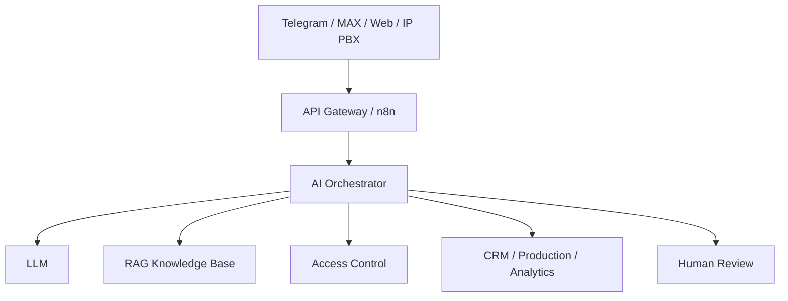

# 👋 Привет! Меня зовут Сергей Иванов | Hi, I'm Sergey Ivanov

**AI Engineer · Prompt Engineer · Business Automation Developer · RAG & AI Agents**

   

[Русская версия](#-кто-я-и-чем-занимаюсь) · [English version](#-who-i-am--what-i-do)

## 🎯 Кто я и чем занимаюсь

Я промпт-инженер и разработчик систем автоматизации бизнес-процессов на основе искусственного интеллекта. Специализируюсь на ИИ-ассистентах, RAG, мультиагентных системах, чат-ботах, CRM и IP-телефонии.

Моя цель — снижать операционные расходы, освобождать сотрудников от рутины, ускорять обработку заказов, улучшать обслуживание клиентов и повышать квалификацию персонала. Мой подход — от анализа бизнес-процесса до проектирования, разработки, интеграции и тестирования решения.

## 🛠 Технический стек

| Направление | Инструменты и технологии |
|---|---|
| AI & LLM | OpenAI API, GPT, Prompt Engineering, AI Agents, RAG, Embeddings, Vision, Speech-to-Text, RAGAS |
| Разработка | Python, aiogram, HTTPX, Requests, REST API, JSON, HTML, CSS |
| Автоматизация | n8n Self-Hosted, Webhooks, Google Docs, Google Sheets |
| Векторные базы | Pinecone, ChromaDB, Weaviate, Semantic Search, Chunking |
| CRM и телефония | Asterisk, FreePBX, SIP, Vtiger CRM, Bitrix24 |
| Мессенджеры | Telegram Bot API, MAX Bot API |
| Инфраструктура и инструменты | Docker, Docker Compose, Linux, Windows, VPS/VDS, SSH, systemd, Git, GitHub, Cursor, VS Code |

## 🚀 Ключевые проекты

### 01. Smart Printing — интеллектуальная платформа полиграфического предприятия
*Проектирование и разработка отдельных компонентов.* ИИ-консультант, калькулятор стоимости, RAG-база знаний, формирование технического задания, CRM, интернет-магазин, обучение сотрудников и виртуальное производство.

### 02. AI Telephony — аналитика телефонных переговоров
*Развёрнутая инфраструктура телефонии; проектирование ИИ-модулей.* Asterisk, FreePBX, транскрибация записей, анализ диалогов, карточки CRM, контроль качества и отчёты телемаркетинга.

### 03. Corporate RAG Assistant — корпоративная база знаний
*Учебные прототипы и развитие архитектуры.* Индексация документов, чанкинг, эмбеддинги, семантический поиск, ответы на основе контекста. Проработка контроля доступа, защиты данных и оценки качества RAG.

### 04. AI Sales Assistant — омниканальный ИИ-менеджер
*Проектирование и разработка компонентов.* Текстовые и голосовые агенты, квалификация клиентов, обработка фотографий и голосовых сообщений, передача диалогов сотруднику, интеграция CRM и телефонии.

### 05. AI Content Factory — мультиагентная система контента
*Архитектура и прототипирование.* Поиск информации, генерация идей и публикаций, проверка фактов, контент-план, редакторское утверждение и публикация в мессенджерах.

### 06. Multimodal AI Bot — мультимодальный ассистент
*Прототипы и адаптация платформ.* Текст, голос, изображения, интерактивные меню, интеграция внешних сервисов, перенос решений между Telegram и MAX.

### 07. AI Image Processing — обработка изображений
*Концепции и прототипирование.* Масштабирование, восстановление деталей, подготовка к широкоформатной печати, панорамные изображения, Real-ESRGAN и Lanczos.

## 💼 Профессиональный опыт

Моё профессиональное направление связано с полиграфией, технологическими и производственными процессами, расчётом себестоимости, продажами, клиентским сервисом и внедрением информационных систем. Этот опыт помогает переводить потребности бизнеса на язык технических решений.

## 🏗 Принципы разработки

Business First · Security by Design · Human-in-the-loop · RAG · Modular Architecture · API First · Scalability · Cost Efficiency · Documentation

## 🎓 Образование и развитие

2026 — обучение промпт-инжинирингу в Университете Zerocoder. Дополнительные направления: Python, RAG, мультиагентные системы, n8n, CRM, IP-телефония, Docker, frontend и безопасность ИИ.

## 🤝 Сотрудничество

Открыт к обсуждению проектов автоматизации бизнеса, ИИ-ассистентов, корпоративных баз знаний, чат-ботов и интеграции информационных систем.

**Моя миссия — освобождать людей от рутинной работы и превращать возможности искусственного интеллекта в реальные бизнес-результаты.**

<!-- Добавьте свои ссылки: email, Telegram, канал, GitHub и репозитории проектов. -->

---

## 🎯 Who I Am & What I Do

I am a Prompt Engineer and Business Automation Developer focused on AI assistants, RAG systems, multi-agent workflows, chatbots, CRM integrations and IP telephony.

My goal is to reduce operating costs, eliminate repetitive work, accelerate order processing, improve customer service and support employee training. My approach covers business process analysis, architecture, development, integration and testing.

## 🛠 Tech Stack

| Area | Technologies |
|---|---|
| AI & LLM | OpenAI API, GPT, Prompt Engineering, AI Agents, RAG, Embeddings, Vision, Speech-to-Text, RAGAS |
| Development | Python, aiogram, HTTPX, Requests, REST API, JSON, HTML, CSS |
| Automation | n8n Self-Hosted, Webhooks, Google Docs, Google Sheets |
| Vector databases | Pinecone, ChromaDB, Weaviate, Semantic Search, Chunking |
| CRM & telephony | Asterisk, FreePBX, SIP, Vtiger CRM, Bitrix24 |
| Messaging | Telegram Bot API, MAX Bot API |
| Infrastructure & tools | Docker, Docker Compose, Linux, Windows, VPS/VDS, SSH, systemd, Git, GitHub, Cursor, VS Code |

## 🚀 Key Projects

### 01. Smart Printing — AI-Powered Printing Business Platform
*Architecture and component development.* AI product consultant, pricing calculator, corporate RAG knowledge base, technical brief generation, CRM, e-commerce and employee training.

### 02. AI Telephony — Intelligent Call Analytics
*Telephony infrastructure deployed; AI modules under design.* Asterisk and FreePBX integration, call transcription, LLM-powered conversation analysis, CRM records, quality monitoring and telemarketing reports.

### 03. Corporate RAG Assistant
*Learning prototypes and architecture development.* Document indexing, chunking, embeddings, semantic retrieval and context-grounded answers. Exploring access control, data protection and RAG evaluation.

### 04. AI Sales Assistant
*Architecture and component development.* Text and voice agents, lead qualification, image and voice processing, human handoff, CRM and telephony integration.

### 05. AI Content Factory
*Architecture and prototyping.* Multi-agent workflows for research, content ideas, drafting, fact-checking, editorial approval and publishing.

### 06. Multimodal AI Bot
*Prototypes and platform adaptation.* Text, voice and image processing, interactive menus, external APIs and Telegram-to-MAX adaptation.

### 07. AI Document Processing
*Learning prototypes.* Receipt recognition, structured data extraction and expense categorization.

### 08. AI Image Processing
*Concepts and prototypes.* Image upscaling, detail restoration, large-format print preparation, panoramic imagery, Real-ESRGAN and Lanczos.

## 💼 Professional Background

My professional interests and practical experience involve printing production, technological workflows, cost estimation, sales, customer service and information systems. This background helps me translate business needs into technical solutions.

## 🛡 Engineering Principles

Business First · Security by Design · Human-in-the-loop · RAG · Modular Architecture · API First · Scalability · Cost Efficiency · Documentation

## 🎓 Education & Continuous Learning

2026 — Prompt Engineering studies at Zerocoder University. Additional areas: Python, RAG, multi-agent systems, n8n, CRM, IP telephony, Docker, frontend development and AI security.

## 🤝 Get in Touch

Open to discussing AI engineering, business automation, intelligent assistants, corporate knowledge bases, chatbots and system integration projects.

**My mission is to eliminate repetitive work and turn AI capabilities into real business results.**

<!-- Add your email, Telegram handle, channel, GitHub profile and project repository links here. -->
